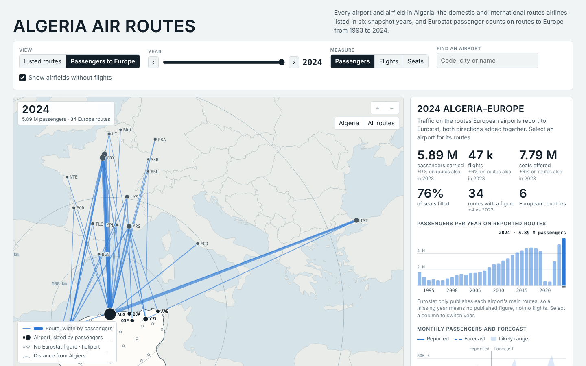
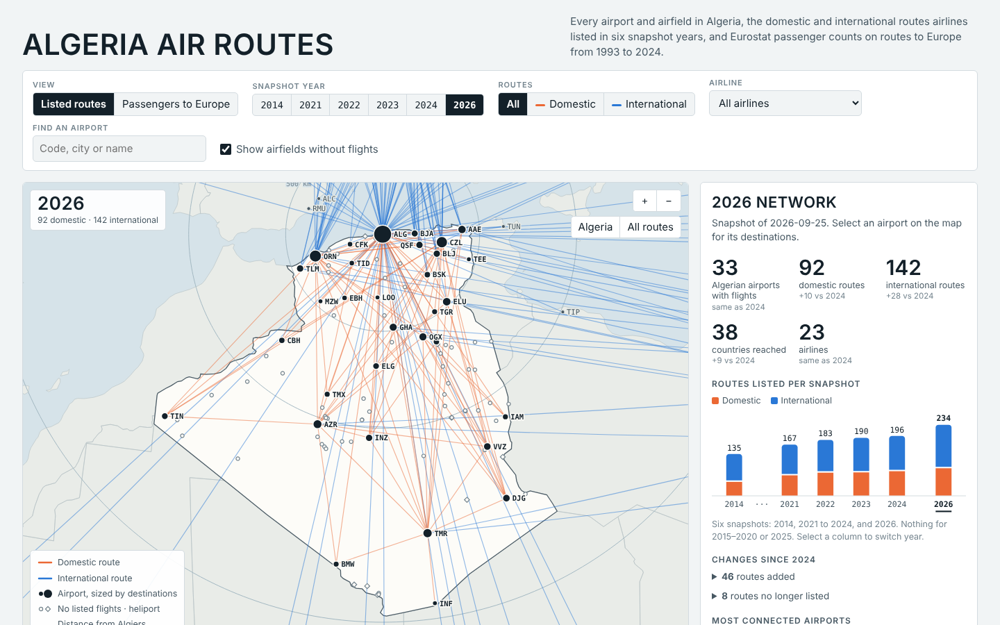

# dz-skies

An open map and dataset of Algeria's air network: every airport, the routes airlines have listed since 2014,
passenger traffic to Europe since 1993, and a tested monthly forecast.



On the routes European airports report to Eurostat, traffic between Algeria and Europe went from 4.30 million
passengers in 2019 to 0.49 million in 2021, and reached 5.89 million in 2024. Part of that swing is coverage:
Eurostat published 27 routes in 2019, 5 in 2021 and 34 in 2024.

## What is here

- **A map** (`site/`): all 110 open airports, airfields and heliports in Algeria. One view shows the domestic and
  international routes listed in six snapshot years (2014, 2021 to 2024, 2026). The other shows passengers, seats and
  flights on Algeria–Europe routes for every year from 1993 to 2024, with a monthly forecast for the next two years.
- **A dataset** (`data/`): the Eurostat figures filtered to Algerian routes, annual and monthly, and the airport list.
- **A pipeline** (`pipeline/`): downloads the sources, builds the site's data and checks it.
- **A forecast benchmark** (`ml/`): a fixed year-ahead test with simple baselines, so new models can be compared fairly.



## Run it

Python 3.10 or newer.

```
pip install -r requirements.txt
python run_all.py
python -m http.server 8000 --directory site
```

Then open http://localhost:8000. The first run downloads about 130 MB of source files into `raw/` and queries
Eurostat a few hundred times, which takes several minutes. `python run_all.py --offline` reuses what is already
there.

| Step | Command | Writes |
|---|---|---|
| Download sources | `python -m pipeline.fetch` | `raw/`, `data/eurostat_algeria_routes_*.csv` |
| Benchmark and forecast | `python ml/backtest.py` | `ml/results/` |
| Build site data | `python -m pipeline.build` | `site/data.json`, `data/airports_dz.csv`, `build/routes_by_year.csv` |
| Validate | `python -m pipeline.validate` | nothing; fails if a check does not pass |

## Data sources

| Source | What it gives | Years |
|---|---|---|
| OurAirports | Airports, airfields and heliports | current |
| OpenFlights | Routes airlines listed | 2014 |
| Jonty/airline-route-data | Routes airlines listed, one late-summer snapshot per year | 2021 to 2024, 2026 |
| Eurostat `avia_par` | Passengers, seats and flights reported by European airports | 1993 to 2024 (monthly from 2002) |
| Natural Earth | Base map | – |

Terms for each source, and two open licensing questions, are in [DATA_LICENSES.md](DATA_LICENSES.md).

## What the data can and cannot tell you

- **A listed route is not a flown route.** The route snapshots record what airlines had on sale around the snapshot
  date. Some listings are stale: Algiers–Casablanca stays listed through 2024 although flights between Algeria and
  Morocco stopped in September 2021.
- **Eurostat only publishes each airport's main routes.** Seven countries have Algerian routes in its tables: France,
  Spain, Italy, Germany, Belgium, Türkiye and the United Kingdom. A missing route-year is unpublished, not zero.
- **Europe only.** Nothing here counts domestic passengers or traffic to Africa, the Middle East or elsewhere.
- **No snapshots for 2015 to 2020 or 2025.**

## Forecast benchmark

Year-ahead forecasts of monthly passengers per route, scored as total absolute error over total passengers:

| Model | 2018 | 2019 | 2023 | 2024 |
|---|---|---|---|---|
| Same month last year (baseline) | 10.9% | 16.1% | 27.3% | 12.5% |
| Baseline + Ramadan/Eid correction | 9.6% | 14.6% | 27.2% | 11.8% |
| Holt-Winters per route | 10.9% | 15.0% | 21.5% | 12.7% |
| Gradient boosting + calendar features | 11.5% | 13.9% | 20.6% | 17.1% |

The site uses the second row. It is the only model that beats the baseline in all four test years. The protocol, all
eight models and how to add yours are in [ml/README.md](ml/README.md).

## Deploying

The workflow in `.github/workflows/update.yml` rebuilds the data and publishes `site/` to GitHub Pages on every push
to `main`, and refreshes the Eurostat figures on the 3rd of each month. To switch it on, set
**Settings → Pages → Source** to **GitHub Actions**.

## Roadmap

- Growth term and wider uncertainty ranges in the forecast
- Route profiles (summer-peaked or steady) and flags on unusual months
- Animation through the years; French and Arabic versions
- A score for unserved Algeria–Europe routes
- Domestic traffic, the biggest gap in the data

## Contributing

See [CONTRIBUTING.md](CONTRIBUTING.md). Data contributions need no coding.

## Licence

Code: MIT. Data: see [DATA_LICENSES.md](DATA_LICENSES.md).
